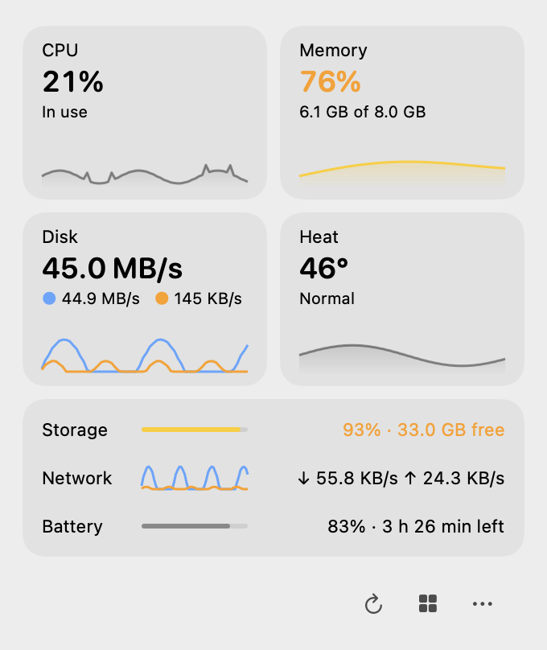
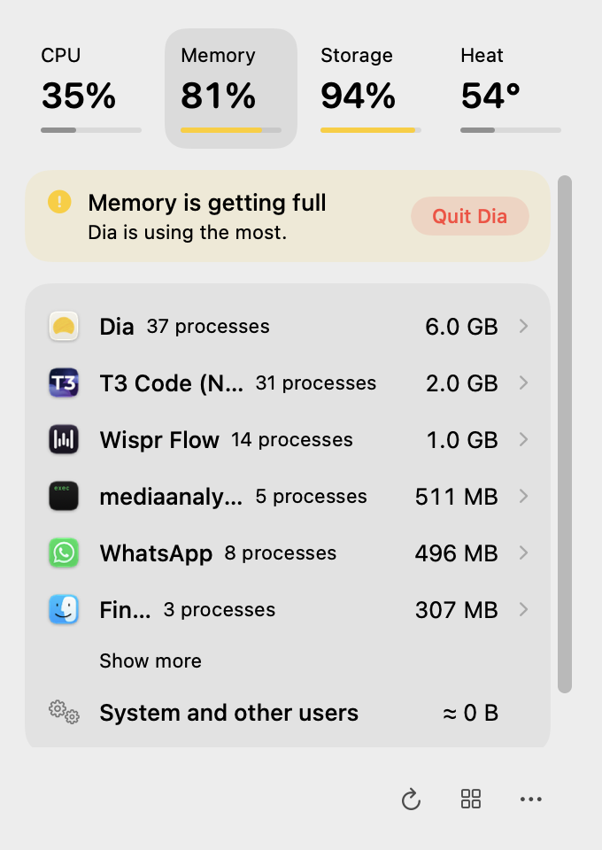

# Vital

[](https://github.com/soumyyy/vital/actions/workflows/ci.yml)
[](https://github.com/soumyyy/vital/releases/latest)
[](LICENSE)


A lean menu bar monitor for Apple Silicon Macs. It answers one question: **what is eating my Mac right now, and can I stop it?**

<p align="center">
  
  &nbsp;&nbsp;
  
</p>

## Install

Download **Vital.dmg** from the [latest release](https://github.com/soumyyy/vital/releases/latest), open it and drag Vital into Applications. The app is signed with a Developer ID and notarized by Apple.

Or with Homebrew:

```sh
brew tap soumyyy/vital https://github.com/soumyyy/vital
brew install --cask soumyyy/vital/vital
```

See [installation and removal](docs/INSTALL.md) for permissions and uninstalling.

## What it does

- **Overview** at a glance: five-minute graphs for CPU, memory, disk and heat, plus storage, network and battery in one-line rows.
- **Four vitals**: CPU, memory, storage and heat. Tap one to see which apps use the most of it. Colour appears only when something needs attention, and that vital's own view then names the app to blame, with a Quit button.
- **Per-app breakdown.** Chrome and its helpers are one entry that expands to its processes. CPU is each app's share of the whole CPU, smoothed over five seconds. Hover a process for the Activity Monitor figure (100% is one core).
- **Quit and Force Quit** with confirmation, protected system processes, and honest results, including processes stuck in the kernel that no signal can kill. Apps that stop responding surface at the top of every view.
- **Details on demand**, closed by default: core split, memory pressure and swap, disk activity per app, temperatures, battery health and cycles, network speed, and which apps keep the Mac awake.
- **Fan control** (optional): live speed and a manual speed slider on MacBooks with fans. See [fan control](docs/FAN-CONTROL.md).
- **Software updates** on request: *Update Software…* checks the latest GitHub release, verifies it and installs it.
- Liquid Glass on macOS 26 and later, frosted material on macOS 14 and 15, opaque with Reduce Transparency.

## Privacy

- No telemetry, no analytics, no accounts.
- The only network request is the update check, and only when you choose *Update Software…*. Downloading an update happens only after you approve it.
- No permission prompts by default. Storage scanning never opens Documents, Desktop, Downloads, Photos, Music, Movies, iCloud Drive or other apps' data unless you press **Scan** on that folder. Full Disk Access is optional.

## Footprint

Measured on a MacBook Pro 14" (M3, 8 GB):

| State | Memory | CPU |
|---|---|---|
| Panel never opened | 12 MB | about 0.02% (wakes every 15 s when calm, every 5 s when busy) |
| Panel open | about 27 MB | about 1.4% (updates every 2 s) |
| Panel closed again | about 26 MB | about 0% |

The 26 MB after closing is the floor for SwiftUI in this process. Going lower would take a separate short-lived UI process.

## How it works

- Direct Mach, libproc and sysctl calls. It never shells out to `ps` or `top`.
- Measuring runs off the main thread at utility priority, skips overlapping ticks and backs off when a tick gets expensive.
- macOS does not let an unprivileged app read memory or exact CPU for root-owned processes, so those appear as one approximate **System and other users** row.
- Temperatures come from the private IOHID sensor client and fans from the SMC. These private APIs are why Vital is not on the Mac App Store and is not sandboxed. A missing sensor shows "n/a", never an invented number.
- `Vital --dump-sensors` prints the sensor and fan inventory as JSON. Please attach it when reporting an unsupported Mac.

## Limits

- Apple Silicon only (M1 and later), macOS 14 or later. Validation so far covers an M3 MacBook Pro on macOS 27; other models and the macOS 14 and 15 appearance have had CI builds only.
- macOS has no per-app temperature, so Heat ranks apps by power draw.
- Intel Macs, alerts, deleting files and a live menu bar readout are not supported.

## Contributing

Bug reports with a `--dump-sensors` dump and pull requests are welcome. See [CONTRIBUTING.md](CONTRIBUTING.md) to build and test, [SECURITY.md](SECURITY.md) to report a vulnerability, and the [changelog](CHANGELOG.md).

## Credits

Sensor approach informed by [Stats](https://github.com/exelban/Stats) and [macmon](https://github.com/vladkens/macmon), both MIT licensed.

## License

[MIT](LICENSE)
